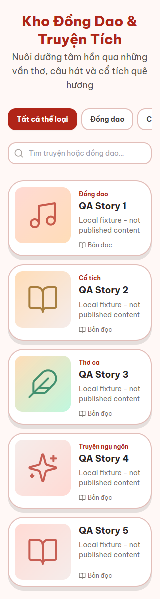
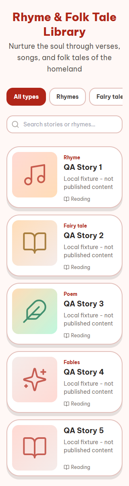
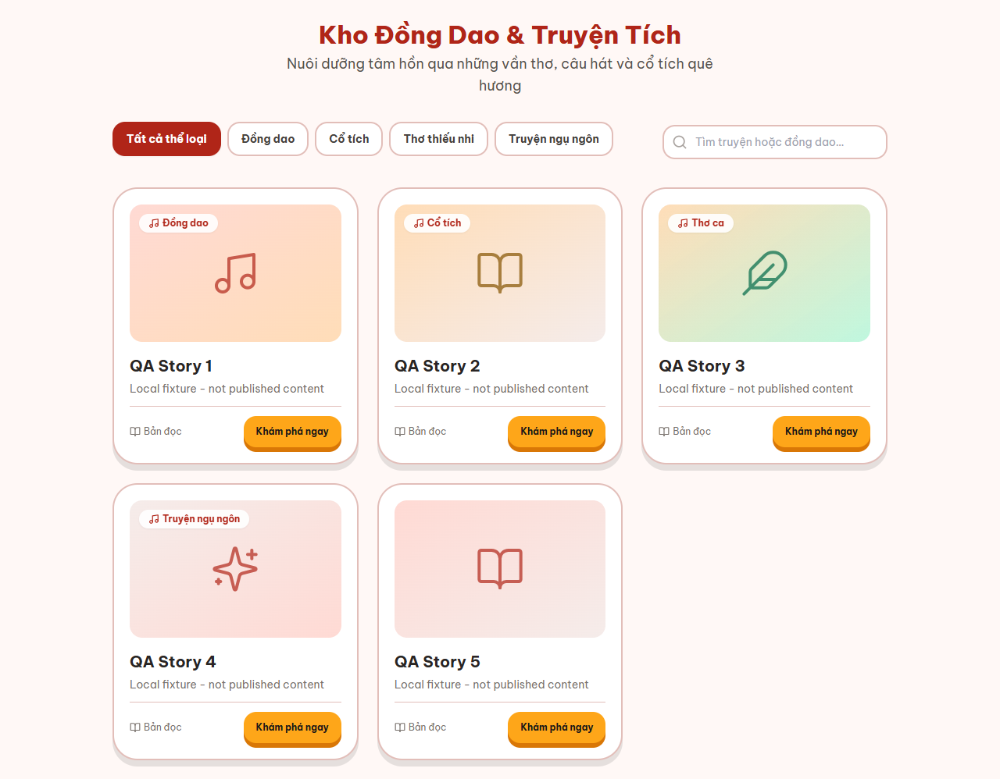
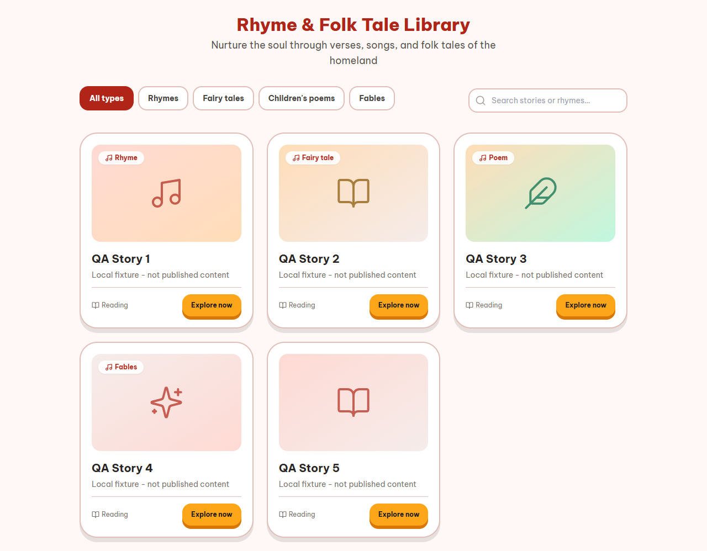

# Story card type labels

Date: 2026-10-18. Task: STORY-TYPE-LABEL, customer audit section 5.6.
Status: implemented and locally verified; not a production acceptance record.

## Existing business decisions

The API's existing StoryType enum is the source for classification. Interface
labels use the selected VI/EN language; story content remains unchanged. This
patch does not resolve the separate taxonomy disagreement in customer docs.

| Server type | Existing translation key | English card label |
| --- | --- | --- |
| dong_dao | stories.badgeDongDao | Rhyme |
| co_tich | stories.badgeCoTich | Fairy tale |
| tho | stories.badgeTho | Poem |
| ngu_ngon | stories.typeNguNgon | Fables |

## Implementation assumptions

- Map all four types explicitly instead of treating every other value as a poem.
- Reuse the existing fable filter label for the badge, without changing either
  shared dictionary. Mobile and desktop badge locations use the same mapping.
- Unknown/missing legacy types have no genre badge or empty badge decoration.
  This is a display fallback, not a new category or a data migration.
- Filters/search, routes, APIs, enum, curriculum, attribution, quiz, audio and
  permissions are unchanged. Loading/error/empty states are unchanged.

## Verification

- Initial clean RED run: 5 failed / 2 passed. Fable labels were absent and
  unknown types had two poem labels. Existing search/filter/navigation passed.
- GREEN: 7 story-label tests plus 10 presentation tests pass; independent
  reviewer reran the same 17 tests and found no actionable code/test issue.
- Initial full `npm test`: 497 backend tests / 51 files and 311 client tests / 36 files
  pass. Uses a temporary MongoDB replica set, not production data.
- After merging main `c7519c0` (header and offline PRs), client 321/321 in
  37 files and server/client typecheck/build pass again; diff-check is clean.
  Story implementation/tests, browser fixture inputs, server code and lockfile
  are unchanged by the merges, so their earlier evidence remains applicable.
- `npm run typecheck`, `npm run build`: server and client pass.
- `npm run lint`: 0 errors, 103 pre-existing warnings. The unrelated audio
  playback test retains its existing React act warning.
- Browser smoke: real StoriesPage and CSS in headless Chrome, local HTTP
  fixture only, VI/EN at 320, 639, 640 and 1280px. Exactly the expected
  mobile/desktop badge is visible for each known type; unknown has none;
  no horizontal page overflow or browser runtime errors.
- `node plans/261018-story-type-label/browser-smoke.mjs` reproduces the smoke
  run. Set PLAYWRIGHT_MODULE to an installed Playwright package and CHROME_PATH
  to Chrome when using a different machine. No package/lockfile changes.

Local fixture screenshots, not published stories:

## Known limits and human actions

- No production publish/write or real-device acceptance. Reviewer should
  check CI on the final head before merging and smoke the deployed story list.
- Historical pre-integration defect: CoverPlaceholder's ordinary
  object lookup accepts an inherited key such as constructor, then receives
  an undefined icon and crashes if the malformed story has no cover. The
  enum does not normally permit this value. This patch does not change that
  shared component; main PR25 subsequently fixed its own-key lookup, and that
  existing fix is preserved in the 2026-10-19 integration. The inherited-key
  badge fixture supplies a cover to isolate the label behavior; other unknown
  fixtures retain the real placeholder. Do not claim arbitrary malformed
  catalog data is fully supported.
- Rollback is a code revert; no migration, secret or external service setup.

## Current-main integration: 2026-10-19

- Human authorized resuming nonaudio delivery. A new isolated worktree preserves
  the old PR head and normally merges main
  `4a6b0a14ed18ff4b9f5be6f33e4889b4c5b3ab66`, producing
  `5e4ae65174aeaa75b2d41503e6f6e07f96a5ef13` without conflicts. Story source,
  label tests and browser harness remain byte-unchanged from the reviewed PR.
- Fresh coordinator checks: story/cover focused37/37; full frontend484/484
  across48 files with one worker; root server/client typecheck and build pass;
  lint0 errors/99 existing warnings. The existing React act warning remains.
- Fresh browser8/8: VI/EN at320/639/640/1280. All four new screenshots were
  inspected using native vision and are byte-identical to the committed images.
  Local synthetic GET/story fixtures only; no real account, publication, device
  or production acceptance. Owned browser/server closed; port5194 is free.
- Historical PR15 CI39141626708 failed F04 recordingFinalize.test.ts:148
  with statuses[201,201,404,201]. That failure remains recorded. Integrating a
  changed main requires new-head CI, not a rerun of the failed old head. No
  local backend suite was rerun for this client-only delta, no audio was edited,
  and these UI checks do not establish F04 repair or audio acceptance.
- Final evidence-only documentation changes do not change the tested inputs.
  Exact remote-head CI/previews, coordinating merge and main postchecks remain
  delivery gates. No force-push, main push, bypass or manual deploy is allowed.
